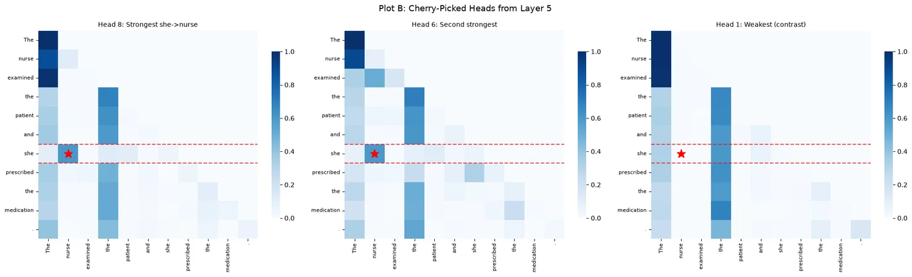
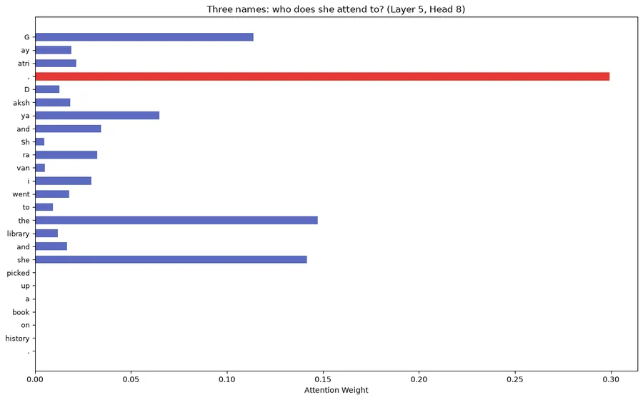
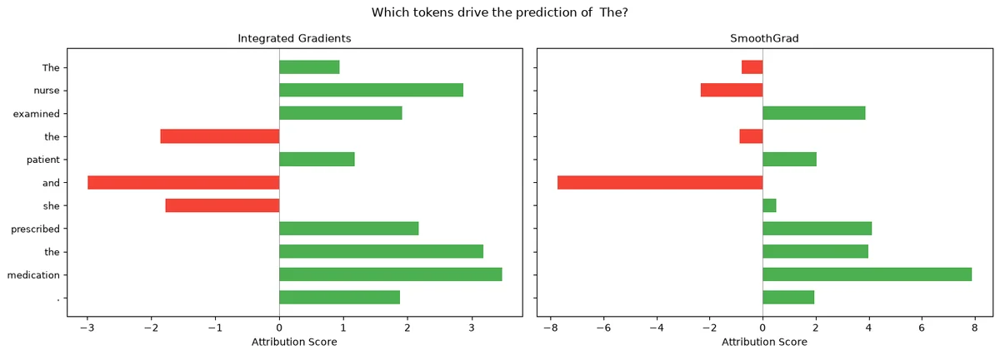
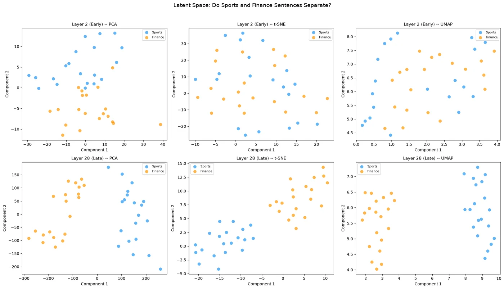
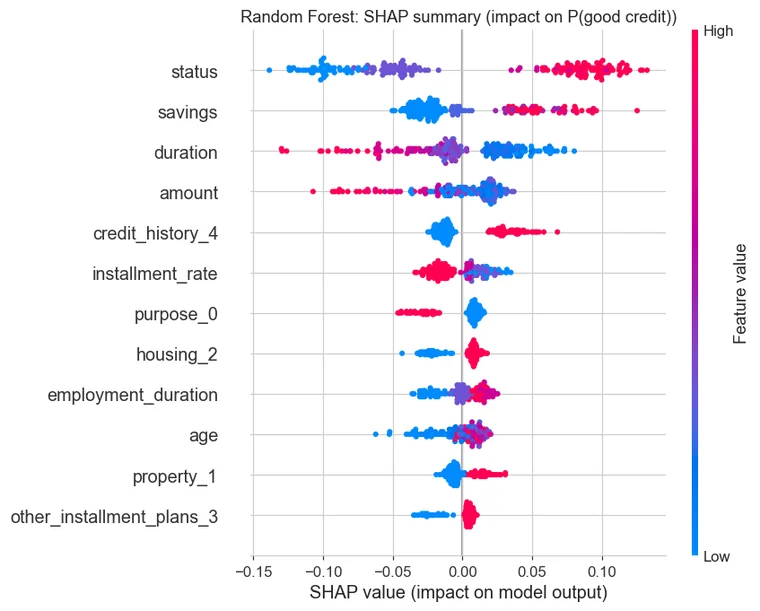
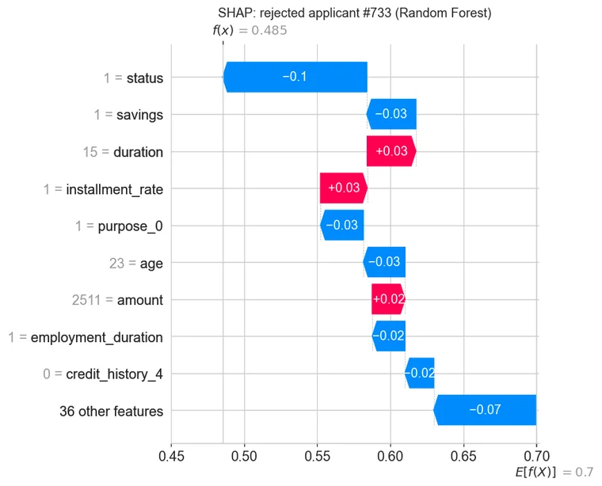
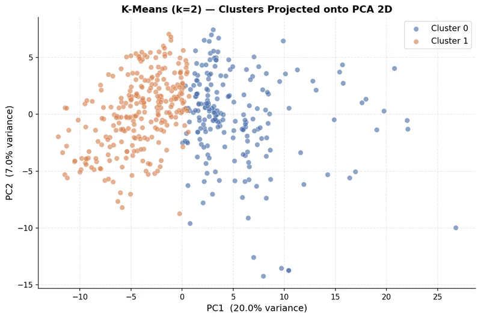
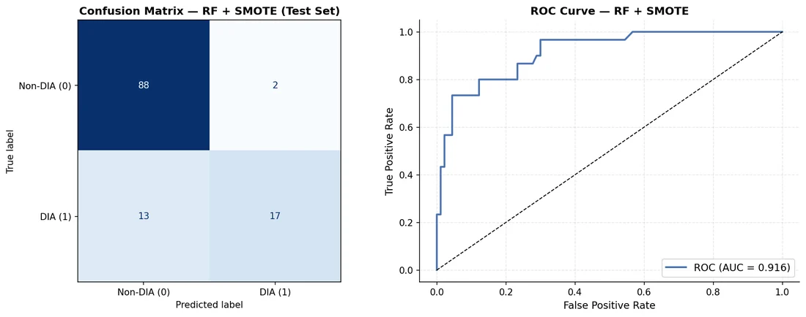

<div align="center">

# Explainable AI Audits

Three audits of three very different models: a small language model, a credit scoring model and a drug toxicity classifier.<br>
Each one asks what the model is really doing, and uses the explanation methods that suit that question.

[![Python][badge-python]][link-python]
[![PyTorch][badge-pytorch]][link-pytorch]
[![Transformers][badge-hf]][link-hf]
[![Captum][badge-captum]][link-captum]
[![SHAP][badge-shap]][link-shap]
[![LIME][badge-lime]][link-lime]
[![DiCE][badge-dice]][link-dice]
[![Weights & Biases][badge-wandb]][link-wandb]
[![License: MIT][badge-license]](LICENSE)

</div>

| | Case study | Model | Methods |
|---|---|---|---|
| 1 | [White-box safety audit of SmolLM-135M](01-smollm-safety-audit) | 30-layer causal language model | Attention-head analysis, Integrated Gradients, SmoothGrad, PCA, t-SNE, UMAP |
| 2 | [Credit risk audit for three stakeholders](02-credit-risk-audit) | Random Forest and Gradient Boosting | SHAP, permutation importance, four-fifths fairness test, LIME, DiCE counterfactuals |
| 3 | [Drug-induced autoimmunity](03-drug-autoimmunity-xai) | Random Forest on molecular descriptors | K-Means with a decision-tree surrogate, SHAP, LIME, Shapash, SMOTE |

## 1. White-box safety audit of SmolLM-135M

Before letting SmolLM-135M ([HuggingFaceTB/SmolLM-135M](https://huggingface.co/HuggingFaceTB/SmolLM-135M), 30 layers, 9 query heads and 3 key-value heads per layer, hidden size 576) complete text automatically, I opened it up and checked three things: whether it tracks who a pronoun refers to, which words actually drive its next-word predictions, and whether it organises topics internally. Every figure and metric was logged to Weights & Biases and collected in a [public W&B report](https://api.wandb.ai/links/rudrasomaiya-vijaybhoomi-university/8n0e6k8l).

### Pronoun resolution through attention

For "The nurse examined the patient and she prescribed the medication.", I scanned all 270 heads for the strongest link from "she" back to "nurse". The winner is layer 5, head 8, which puts 60% of the attention from "she" on "nurse"; head 6 in the same layer is close behind at 0.596.

<p align="center">
  
</p>

Then I made the reference ambiguous: "Gayatri, Dakshya and Shravani went to the library and she picked up a book on history." The same head no longer points at a name. Its largest weight (0.30) lands on the comma right after the first name, the first name's opening token gets another 0.11, and the third name's tokens get very little, so when the referent is unclear the head falls back on whoever was mentioned first.

<p align="center">
  
</p>

### What actually drives the prediction

Attention shows where the model looks, not what it uses. Captum's Integrated Gradients (50 steps from a zero-embedding baseline) and SmoothGrad (a noise tunnel over Integrated Gradients, averaged over 15 noisy copies of the input) score each token's contribution to the predicted next token, " The".

<p align="center">
  
</p>

Both methods agree that "medication" and "prescribed" push towards the prediction and that "and" pushes hardest against it. They disagree on "nurse": positive under Integrated Gradients (+2.87), negative under SmoothGrad (-2.33). An explanation that changes sign with the method is not one to rely on.

### Topics in the hidden states

I mean-pooled the hidden states of 20 sports sentences and 20 finance sentences at layer 2 and layer 28 and projected them with PCA, t-SNE and UMAP. At layer 2 the topics overlap (PCA shows a partial split, t-SNE and UMAP mix them). At layer 28 all three projections separate them cleanly, so topic structure builds up with depth even though the model was only trained to predict the next word.

<p align="center">
  
</p>

### Recommendation

Pronoun tracking works in a few heads when the sentence is clear but breaks down under ambiguity, and token attributions depend on the method. Topic organisation in the late layers is sound. By the audit's own rule, weaknesses in any area mean the model should only be deployed with guardrails (human review, a restricted domain, output filtering) or after further fine-tuning.

## 2. Credit risk audit for three stakeholders

A loan default model gets questioned by different people for different reasons. I trained a Random Forest and a Gradient Boosting model on the [South German Credit data](https://archive.ics.uci.edu/dataset/522/south+german+credit) (1,000 applicants, 700 good and 300 bad, 20 features) and explained them for three audiences.

| Stakeholder | Question | Methods |
|---|---|---|
| Regulator | Is the model sensible overall, and does it discriminate? | Built-in and permutation importance, global SHAP, four-fifths disparate-impact test |
| Loan officer | Why was this applicant scored this way? | LIME, cross-checked with a SHAP waterfall for the same applicant |
| Customer | What would change the decision? | DiCE counterfactuals limited to features the applicant can change |

Both models were tuned with `RandomizedSearchCV` and 5-fold stratified cross-validation on an 80/20 split, inside a pipeline that one-hot encodes the nominal features.

| Model | Cross-validated ROC-AUC | Test ROC-AUC | Test accuracy | Precision | Recall | F1 |
|---|---|---|---|---|---|---|
| Random Forest | 0.781 | 0.829 | 0.78 | 0.782 | 0.950 | 0.858 |
| Gradient Boosting | 0.777 | 0.838 | 0.80 | 0.825 | 0.907 | 0.864 |

Precision, recall and F1 are for the "good credit" class. Both models also went through a calibration check, since lenders use predicted probabilities directly for pricing and reserves.

### Regulator

Both models rely on the same drivers in the expected direction: checking-account status, savings, loan duration and amount. Two differently built models agreeing is evidence that the pattern is in the data, not an artefact of one algorithm.

<p align="center">
  
</p>

The four-fifths rule asks whether the less favoured group is approved at least 80% as often as the other group:

| Group comparison | Random Forest | Gradient Boosting |
|---|---|---|
| Foreign worker vs not | 0.94, passes | 0.775, fails |
| Age under 25 vs 25 and over | 0.744, fails | 0.617, fails |

Both models approve applicants under 25 noticeably less often. That is not automatically unlawful, because age correlates with legitimate risk factors the model also sees (shorter employment, fewer existing credits, less time at the current address), but it is exactly what a regulator would ask the lender to justify. Only the Random Forest passes on foreign workers.

### Loan officer

LIME fits a simple local model around one prediction, which is fast enough for someone reviewing files one at a time. For a rejected applicant (P(good) = 0.485), LIME and the SHAP waterfall below agree on the reasons: both put the missing checking account and the lack of savings at the top, and both count the applicant's age (23) and the loan purpose against them.

<p align="center">
  
</p>

### Customer

DiCE searches for small changes to the applicant's own record that flip the decision. Age, sex and marital status, foreign-worker status, dependants, telephone, job, employment duration and credit history are excluded, because an applicant cannot or should not change them. For a borderline applicant (P(good) = 0.497) it found two options: one changes seven features, including raising savings above 1,000 DM and dropping the guarantor; the other shortens the loan from 30 months to 4 and cuts the amount from 2,150 DM to 250 DM. Both flip the decision, but neither is very practical advice, which shows how much counterfactual quality depends on the constraints you give the search.

## 3. Drug-induced autoimmunity

The [Drug Induced Autoimmunity Prediction dataset](https://archive.ics.uci.edu/dataset/1104/drug_induced_autoimmunity_prediction) describes 597 drugs with 196 RDKit molecular descriptors: 477 for training (118 cause autoimmune disease) and 120 for testing (30 do). The task is to predict which compounds carry that risk, and to understand what the model bases that on.

### Unsupervised structure

PCA on the scaled descriptors explains 27% of the variance in two components. K-Means picks k = 2 by silhouette score, and a depth-4 decision tree reproduces the clusters with 96.9% fidelity, which makes them easy to explain: one feature, `Chi0`, a connectivity index that grows with molecule size, carries 86% of the tree's importance.

<p align="center">
  
</p>

The clusters have nothing to do with the label, though: each is about 24% autoimmunity-positive, the same as the dataset as a whole. The biggest structure in descriptor space is molecule size, not toxicity, which is why the supervised model is needed.

### Supervised model

| Model | Test ROC-AUC | Accuracy | Recall (DIA) | Precision (DIA) |
|---|---|---|---|---|
| Random Forest | 0.912 | 0.81 | 0.27 | 0.89 |
| Random Forest + SMOTE | 0.916 | 0.88 | 0.57 | 0.89 |

The plain Random Forest ranks drugs well (ROC-AUC 0.912) but at the default threshold it catches only 8 of the 30 risky drugs. Oversampling the minority class with SMOTE before training more than doubles recall at the same precision.

<p align="center">
  
</p>

SHAP, LIME and an interactive Shapash dashboard explain the model globally and for individual drugs. The importance is spread thinly: the top descriptors (`SMR_VSA10`, `PEOE_VSA8`, `SlogP_VSA10`, all surface-area contributions) each account for only about 0.02 in mean absolute SHAP value, while the remaining 177 descriptors together account for 0.33. No single property explains autoimmunity risk here.

## Running the notebooks

Case study 1 has its own uv project with locked versions:

```bash
cd 01-smollm-safety-audit
uv sync
uv run --with jupyterlab jupyter lab
```

It needs a free [Weights & Biases](https://wandb.ai) account (`wandb login`); everything runs on a CPU in a few minutes.

Case studies 2 and 3 use the root requirements:

```bash
pip install -r requirements.txt
jupyter lab
```

Their datasets are included (both are CC BY 4.0), so the notebooks run as they are.

## Repository layout

```
.
├── 01-smollm-safety-audit/
│   ├── smollm_whitebox_audit.ipynb
│   └── pyproject.toml, uv.lock
├── 02-credit-risk-audit/
│   ├── credit_risk_xai_audit.ipynb
│   ├── SouthGermanCredit.asc
│   └── figs/                       Figures written by the notebook
├── 03-drug-autoimmunity-xai/
│   ├── drug_autoimmunity_xai.ipynb
│   └── drug_induced_autoimmunity_prediction/
├── docs/images/                    Figures used in this README
└── requirements.txt
```

## Limitations

- The SmolLM audit tests one clear sentence and one ambiguous one. A pronoun benchmark with many sentences (Winogender-style templates, for example) would show whether the patterns hold.
- Attention weights are not explanations on their own, which is why the audit pairs them with gradient attributions; even so, the two attribution methods disagree on some tokens.
- The credit models are trained on 1,000 records from the 1970s, so the fairness results describe this dataset, not current lending.
- The DiCE counterfactuals are mathematically valid but not always realistic; adding plausibility constraints, or ranges for each feature, would make them more useful to customers.
- The drug classifier is evaluated on a single 120-compound test set, of which only 30 are positive.

## Data credits

- South German Credit: Grömping, U. (2019). *South German Credit Data: Correcting a Widely Used Data Set.* UCI Machine Learning Repository, CC BY 4.0.
- Drug Induced Autoimmunity Prediction: Huang, X. (2025). UCI Machine Learning Repository, https://doi.org/10.24432/C5332M, CC BY 4.0.

## License

Code released under the [MIT License](LICENSE).

## Author

Made by Rudra Somaiya.

[![GitHub][badge-github]][link-github]
[![LinkedIn][badge-linkedin]][link-linkedin]

[badge-python]: https://img.shields.io/badge/Python-3776AB?style=for-the-badge&logo=python&logoColor=white
[badge-pytorch]: https://img.shields.io/badge/PyTorch-EE4C2C?style=for-the-badge&logo=pytorch&logoColor=white
[badge-hf]: https://img.shields.io/badge/Transformers-FFD21E?style=for-the-badge&logo=huggingface&logoColor=black
[badge-captum]: https://img.shields.io/badge/Captum-812CE5?style=for-the-badge
[badge-shap]: https://img.shields.io/badge/SHAP-FF0051?style=for-the-badge
[badge-lime]: https://img.shields.io/badge/LIME-32CD32?style=for-the-badge
[badge-dice]: https://img.shields.io/badge/DiCE-0078D4?style=for-the-badge
[badge-wandb]: https://img.shields.io/badge/Weights_%26_Biases-FFBE00?style=for-the-badge&logo=weightsandbiases&logoColor=black
[badge-license]: https://img.shields.io/badge/License-MIT-F7DF1E?style=for-the-badge
[badge-github]: https://img.shields.io/badge/GitHub-RudraSomaiya-181717?style=for-the-badge&logo=github&logoColor=white
[badge-linkedin]: https://img.shields.io/badge/LinkedIn-Rudra_Somaiya-0A66C2?style=for-the-badge&logo=data:image/svg%2bxml;base64,PHN2ZyB4bWxucz0iaHR0cDovL3d3dy53My5vcmcvMjAwMC9zdmciIHZpZXdCb3g9IjAgMCAyNCAyNCI+PHBhdGggZmlsbD0iI2ZmZiIgZD0iTTIwLjQ1IDIwLjQ1aC0zLjU2di01LjU3YzAtMS4zMy0uMDItMy4wNC0xLjg1LTMuMDQtMS44NSAwLTIuMTQgMS40NS0yLjE0IDIuOTR2NS42N0g5LjM1VjloMy40MXYxLjU2aC4wNWMuNDgtLjkgMS42NC0xLjg1IDMuMzctMS44NSAzLjYgMCA0LjI3IDIuMzcgNC4yNyA1LjQ2djYuMjh6TTUuMzQgNy40M2EyLjA2IDIuMDYgMCAxIDEgMC00LjEyIDIuMDYgMi4wNiAwIDAgMSAwIDQuMTJ6TTcuMTIgMjAuNDVIMy41NlY5aDMuNTZ2MTEuNDV6TTIyLjIyIDBIMS43N0MuNzkgMCAwIC43NyAwIDEuNzN2MjAuNTRDMCAyMy4yMy43OSAyNCAxLjc3IDI0aDIwLjQ1Yy45OCAwIDEuNzgtLjc3IDEuNzgtMS43M1YxLjczQzI0IC43NyAyMy4yIDAgMjIuMjIgMHoiLz48L3N2Zz4=
[link-python]: https://www.python.org
[link-pytorch]: https://pytorch.org
[link-hf]: https://huggingface.co/docs/transformers
[link-captum]: https://captum.ai
[link-shap]: https://shap.readthedocs.io
[link-lime]: https://github.com/marcotcr/lime
[link-dice]: https://github.com/interpretml/DiCE
[link-wandb]: https://wandb.ai
[link-github]: https://github.com/RudraSomaiya
[link-linkedin]: https://www.linkedin.com/in/rudra-somaiya/
